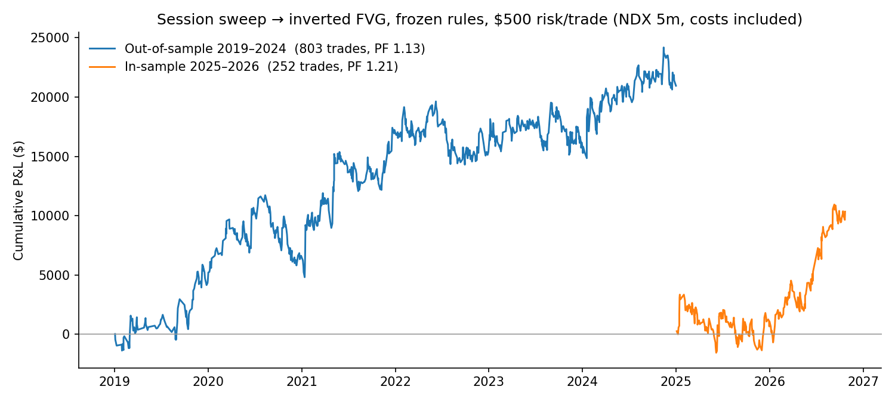

# MNQ Session-Sweep Backtester

I turned a discretionary day-trading model into code and then tested it on 6 years of data it had never seen.

The model is an ICT-style setup on Nasdaq futures (MNQ). Price runs the Asia or London session high or low, a 5-minute fair value gap breaks, and the trade enters on the retest. I traded this by eye first. This repo is me finding out whether it actually works.



## Result

The rules were tuned on 2025–2026, then frozen and run on 2019–2024 without any changes.

| Period | Trades | Win % | Profit factor | Net P&L | Max drawdown |
|---|---|---|---|---|---|
| 2025–2026 (tuned here) | 252 | 52% | 1.21 | +$10,340 | −$4,903 |
| 2019–2024 (never seen) | 803 | 53% | 1.13 | +$20,962 | −$6,912 |

Every trade risks $500 and pays fees plus slippage. Profit factor is dollars won divided by dollars lost.

| Year | Trades | Win % | Profit factor | Net P&L |
|---|---|---|---|---|
| 2019 | 94 | 59% | 1.26 | +$4,522 |
| 2020 | 123 | 55% | 1.08 | +$2,100 |
| 2021 | 152 | 57% | 1.37 | +$10,616 |
| 2022 | 148 | 51% | 0.94 | −$1,863 |
| 2023 | 142 | 49% | 1.03 | +$806 |
| 2024 | 144 | 49% | 1.15 | +$4,772 |
| 2025 | 137 | 50% | 1.04 | +$1,085 |
| 2026 | 115 | 56% | 1.47 | +$9,255 |

**My read.** The edge looks real but thin. It made money in 5 of the 6 years it had never seen. It lost in the 2022 bear market and was flat in 2023. A profit factor around 1.1–1.2 is small enough that real-world fills could erase it. That's why the next step is paper trading, not money.

## The rules

All times are New York. The short side is shown, and longs are the mirror image.

1. Mark the Asia session (18:00–03:00) and London session (03:00–09:00) highs and lows.
2. Draw a fib over the last 3 days' range. Shorts only count from the premium half.
3. Between 09:30 and 12:00, price trades above an Asia or London high. That's the sweep. If the two highs are within 30 points, both must be taken.
4. The most recent 5-minute bullish fair value gap on that push gets closed through. That's the inversion.
5. Price taps back into the gap. Enter short on the first 5-minute close back out of it.
6. The stop goes 1 tick above the sweep's high.
7. The target is the nearest unmitigated higher-timeframe level: a 1H or 4H gap, an order block, or a 15m gap up to 2 days old.
8. Take at most 2 trades a day. Close anything still open at 16:00.

Position size is set so each trade risks $500, capped at 50 micro contracts.

## How the test avoids fooling itself

- **Frozen rules.** I tested about 30 variations on 2025–2026, picked the best, wrote it down, and stopped tuning. The 2019–2024 run used those exact rules.
- **Fills lean against me.** If the stop and target are both inside one bar, the stop wins. Every round trip pays $1.24, and stops pay 1 tick of slippage.
- **No peeking ahead.** Levels are fixed at 09:15 from data available at that time, and entries only fill on bars that have already closed.
- **Variations that lost are listed** so the winner isn't shown alone. Worse than the frozen rules: 1-minute entries, a 1H/4H trend filter, entering on the break candle, closing at 12:00, fixed 2R targets, session-level targets, and trades after 12:00.

## Limits

- **The data isn't the exact contract.** It's Dukascopy's Nasdaq-100 CFD minute data, which moves with MNQ futures (about 0.97 correlation) but isn't identical.
- **2019 and 2020 have gaps.** About 73 days are missing from 2019 and about 34 from 2020, because the data server failed on those days.
- **Bar-level fills, not tick-level.** Real fills could be worse.
- **This is not financial advice.** I'm running it as a paper bot before risking anything.

## Run it

The data isn't included, so download it first. You'll need Python 3.9+ and Node for the downloader.

```bash
pip install -r requirements.txt

# 1. Download Nasdaq-100 1-minute data (free, no account needed)
python3 duka_fetch.py 2019-01-01 2025-01-01 duka/oos

# 2. Join the files and build 5m + 15m bars
cat duka/oos/*.csv > OOS_1m.csv   # keep only the first header line
python3 make_bars.py OOS_1m.csv OOS

# 3. Run the frozen rules
SWEEP_START=09:30 MAX_TRADES=2 RISK_USD=500 ENTRY_MODE=cont FIB=swing ENTRY_END=12:00 \
  python3 sweep_ifvg.py OOS_5m.csv OOS_15m.csv

# 4. Redraw the chart and the yearly table from the results files
python3 plot_equity.py
```

The output prints stats for 4 target styles. The frozen rules use the `pdra` target.

## Files

| File | What it does |
|---|---|
| `sweep_ifvg.py` | The strategy engine: levels, sweeps, gaps, entries, exits, stats |
| `make_bars.py` | Turns 1-minute data into 5m and 15m bars |
| `duka_fetch.py` | Downloads Dukascopy data week by week, retrying failed days |
| `plot_equity.py` | Builds the equity chart and the yearly table |
| `results/` | Day-by-day trades and summary stats for both periods |

Built with Python and pandas, with Claude Code as a pair programmer.
